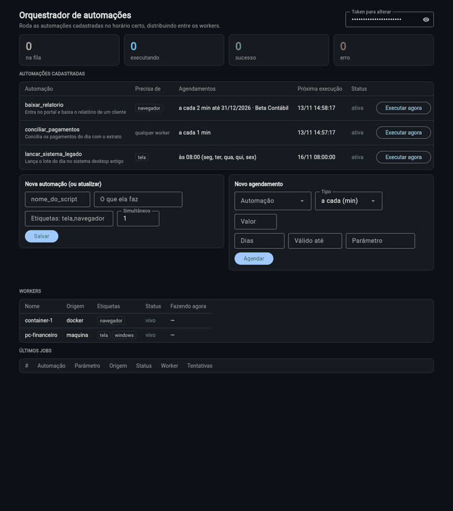

# Orquestrador de automações

Roda as automações cadastradas no horário certo e distribui o trabalho entre várias máquinas.
Quando a fila enche, liga mais workers sozinho. Se um worker cai no meio de um job, o job volta para
a fila e outro termina.



> Projeto de demonstração, com dados fictícios.

## O problema

Empresa com dezenas de robôs costuma agendar tudo no Agendador do Windows, de uma máquina só:
- não tem fila, então tudo dispara junto às 8h e a máquina engasga;
- ninguém sabe o que rodou e o que falhou sem abrir log por log;
- se a máquina cai no meio, o trabalho some;
- robô que precisa de tela (sistema desktop antigo) disputa a mesma máquina com robô que não precisa.

## A solução

Um **master** guarda o cadastro e a agenda das automações e distribui os jobs. Vários **workers**,
em container, VM ou PC, pedem trabalho a ele.

```text
master (API + painel + loop a cada 1 s)
├─ 1. desativa agendamentos fora da validade
├─ 2. calcula a próxima execução dos agendamentos novos
├─ 3. põe na fila o que chegou a hora (e já marca a próxima)
├─ 4. marca como morto o worker sem sinal de vida
├─ 5. devolve à fila o job de worker que sumiu (na 3ª vez, desiste e marca erro)
└─ 6. escala: fila cheia → liga um worker extra; fila vazia → desliga um extra parado

worker (quantos quiser, onde quiser)
├─ se registra com as etiquetas dele: navegador, tela, windows...
├─ manda sinal de vida a cada 2 s (isso renova o prazo do job atual)
└─ pede o próximo job → roda a automação em processo separado → devolve o código de saída
```

Cada etapa do loop tem o próprio `try`: uma falha não para as outras, e o mesmo erro não é
registrado de novo a cada segundo.

### Decisões que importam

- **O worker é que pede trabalho.** O master nunca conecta nas máquinas, então tanto faz se o worker
  é um container na nuvem ou o PC do financeiro atrás de um firewall.
- **Etiquetas.** Um job que precisa de `tela` só vai para worker com `tela`. Container Linux não tem área
  de trabalho do Windows. Para automação de programa desktop, o mesmo `worker.py` roda numa máquina
  Windows de verdade, e o master não vê diferença.
- **Limite de execuções simultâneas por automação.** O padrão é 1: a automação nunca roda duas vezes
  ao mesmo tempo, o que protege rotinas que gravam no mesmo lugar. Uma automação como "baixar o relatório
  de cada cliente" pode liberar 10 ao mesmo tempo.
- **Job "emprestado" com prazo.** O worker recebe o job com prazo de 8 s, renovado pelo sinal de vida.
  Se o worker some, o prazo vence e o job volta para a fila. Se o worker antigo aparece depois com o
  resultado, ele é ignorado, porque o job já é de outro.
- **Código de saída é o contrato.** 0 = sucesso, qualquer outro = erro. Sem "falha silenciosa".
- **Escala com freio.** Liga no máximo um extra por vez, com espera entre um e outro, e só desliga
  extra que não está com job.
- **Segurança.** Tudo que altera algo exige o token (`X-Token`, comparado em tempo constante). Nome de
  automação vira nome de arquivo no worker, então só aceita `[a-z0-9_]`. O parâmetro do job vai como
  argumento, nunca por shell.

## Como rodar

### Local, sem Docker (workers como processos)

```bash
python -m venv .venv && .venv\Scripts\activate      # no Linux: source .venv/bin/activate
pip install -r requirements.txt
set ORQ_TOKEN=um-segredo-longo                       # no Linux: export ORQ_TOKEN=...

python master.py                                      # painel em http://localhost:8000
python worker.py --master http://localhost:8000 --nome container-1 --etiquetas navegador
python worker.py --master http://localhost:8000 --nome pc-financeiro --etiquetas tela,windows

python disparar.py baixar_relatorio --clientes 20    # enche a fila e o master liga os extras
```

Na primeira vez, o master cadastra três automações de exemplo (`exemplos.json`) com agendamentos.
Pelo painel dá para cadastrar outras, agendar e executar na hora (o token vai no campo do topo).

### Com Docker

```bash
cp .env.exemplo .env          # e troque o ORQ_TOKEN
docker compose up --build
```

Sobe o master e um worker. Com a fila cheia, o master cria containers de worker extras na mesma rede,
pela API do Docker. Para isso o compose monta o `docker.sock`, o que dá ao master controle sobre o
Docker do host. Em produção, rode o master numa máquina dedicada a isso.

> O GIF do topo foi gravado no modo local; no Docker, a lógica de escala é a mesma, só que os extras são containers.

## Agendamentos

| Tipo | Exemplo | Quando roda |
|---|---|---|
| `intervalo` | `{"tipo": "intervalo", "a_cada_min": 15}` | a cada 15 minutos |
| `diario` | `{"tipo": "diario", "horario": "08:00", "dias": [0,1,2,3,4]}` | às 08:00, de segunda a sexta |

Todo agendamento aceita `valido_ate` (AAAA-MM-DD), que o desativa sozinho depois da data, e um
`parametro` opcional, que é passado ao script.

## API

| Rota | Para quê | Token |
|---|---|---|
| `GET /` | painel | — |
| `GET /estado` · `GET /automacoes` | dados do painel | — |
| `POST /automacoes` | cadastrar ou atualizar automação | sim |
| `POST /automacoes/{nome}/agendamentos` | agendar | sim |
| `POST /jobs` | executar agora (um job por parâmetro) | sim |
| `POST /workers` · `/workers/{id}/sinal` · `/workers/{id}/proximo` | uso dos workers | sim |
| `POST /jobs/{id}/concluir` | worker devolve o resultado | sim |

## Estrutura

```text
master.py            # API, painel e o loop (agenda, recupera, escala)
banco.py             # todas as regras: agenda, fila, etiquetas, prazos (SQLite)
escalador.py         # liga e desliga workers extras (processo ou container)
worker.py            # pede jobs, roda a automação, manda sinal de vida
painel.html          # painel que atualiza sozinho
automacoes/          # as automações de exemplo (scripts Python)
exemplos.json        # cadastro inicial: automações e agendamentos
config.json          # prazos, intervalos e regras de escala
disparar.py          # dispara jobs pela linha de comando
tests/test_banco.py  # 17 testes das regras
Dockerfile, docker-compose.yml
```

## Testes

```bash
pip install pytest
pytest
```

Cobrem: intervalo e horário diário (incluindo pular fim de semana), validade, automação desativada,
etiquetas, limite simultâneo, worker que some, sinal de vida renovando o prazo, máximo de tentativas,
resultado atrasado de worker antigo e worker morto × desligado.

---

Feito por **João Aracheski**. [LinkedIn](https://www.linkedin.com/in/joaoaracheski/) · [Telegram](https://t.me/joaoaracheski)
